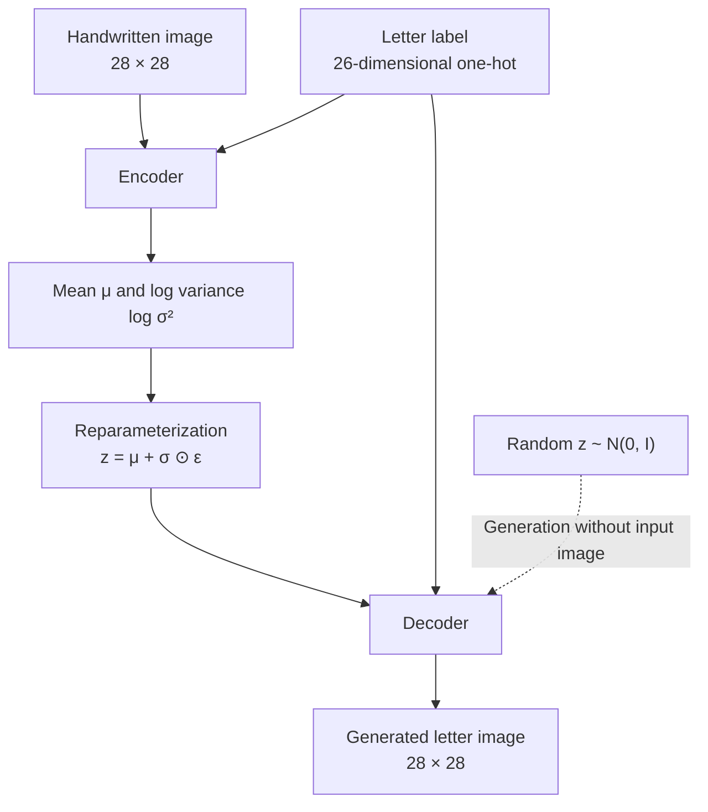

<div align="center">

# ✍️ HandWriteEnglishGenerator

### Generating Handwritten English Letters with a Conditional VAE

**조건부 변이형 오토인코더(CVAE)를 이용한 영어 손글씨 알파벳 생성 프로젝트**

영문 알파벳과 무작위 잠재벡터를 입력해, 서로 다른 형태의 손글씨 이미지를 생성합니다.

<br>


<br>

[](https://colab.research.google.com/github/oyueo-mm/HandWriteEnglishGenerator/blob/main/%EC%86%90%EA%B8%80%EC%94%A8_%EC%95%8C%ED%8C%8C%EB%B2%B3_%EC%83%9D%EC%84%B1%2C_CVAE.ipynb)
[](https://github.com/oyueo-mm/HandWriteEnglishGenerator/blob/main/%EC%86%90%EA%B8%80%EC%94%A8_%EC%95%8C%ED%8C%8C%EB%B2%B3_%EC%83%9D%EC%84%B1%2C_CVAE.ipynb)

</div>

---

## 📖 Overview

**HandWriteEnglishGenerator**는 딥러닝 생성 모델인 **Conditional Variational Autoencoder (CVAE)**를 사용해 영어 알파벳 손글씨를 생성하는 실험 프로젝트입니다.

일반적인 오토인코더와 달리 **알파벳 레이블을 조건(condition)**으로 제공하므로, 원하는 글자를 지정하면서도 잠재공간에서 샘플링한 값에 따라 다양한 형태를 생성할 수 있습니다. 학습부터 샘플 생성까지 하나의 Google Colab 노트북으로 구성했습니다.

## ✨ Features

- **A–Z 조건부 생성:** 26개 영어 알파벳 클래스 중 원하는 글자 선택
- **다양한 필체 샘플링:** 잠재벡터 `z`를 무작위로 추출해 같은 글자의 변형 생성
- **문자열 시각화:** 입력한 영어 텍스트를 글자별 이미지로 생성해 나란히 표시
- **학습 과정 시각화:** 학습 도중 알파벳별 생성 결과를 그리드로 확인
- **모델 저장 및 내보내기:** 학습된 가중치를 `.pth`로 저장하고 디코더 파라미터를 CSV로 내보내는 코드 포함

> **참고:** 이 프로젝트는 28×28 크기의 **개별 알파벳 이미지**를 생성합니다. 단어 및 문장은 글자 이미지를 나란히 배치한 결과이며, 연결된 필기체나 자연스러운 문장 단위 필기 궤적을 생성하는 모델은 아닙니다.

## 🧠 Model Architecture



**생성 과정:** 추론할 때는 입력 손글씨 이미지 없이, 무작위 잠재벡터 `z`와 글자 레이블을 디코더에 전달하여 이미지를 만듭니다.

| 항목 | 설정 |
|:--|:--|
| 모델 | Conditional Variational Autoencoder (CVAE) |
| Encoder | Fully Connected: `810 → 512 → 256 → (μ, logσ²)` |
| Decoder | Fully Connected: `46 → 256 → 512 → 784` |
| 입력 이미지 | 28 × 28, Grayscale |
| 조건 | 알파벳 26개 클래스 (One-hot encoding) |
| Latent dimension | `20` |
| Loss | Binary Cross-Entropy + KL Divergence |
| Optimizer | Adam (`lr=0.001`) |
| Batch size / Epochs | `128` / `50` |

## 📚 Dataset

[A–Z Handwritten Alphabets in CSV Format (Kaggle)](https://www.kaggle.com/datasets/sachinpatel21/az-handwritten-alphabets-in-csv-format)을 사용합니다.

- **데이터:** 영어 알파벳 A–Z의 손글씨 이미지
- **형식:** 각 샘플은 알파벳 클래스 레이블과 28×28 이미지 픽셀값으로 구성
- **전처리:** 픽셀을 `0–1` 범위로 정규화하고 PyTorch 텐서로 변환
- **데이터 다운로드:** 노트북에서 `kagglehub`로 다운로드

## 🚀 Getting Started

### 1. Google Colab에서 열기

상단의 **Open in Colab** 버튼으로 노트북을 열고, 위에서 아래로 셀을 실행합니다. GPU를 사용하려면 Colab에서 **런타임 → 런타임 유형 변경 → GPU**를 선택합니다.

### 2. 로컬에서 실행하기

```bash
git clone https://github.com/oyueo-mm/HandWriteEnglishGenerator.git
cd HandWriteEnglishGenerator
python -m pip install torch torchvision numpy pandas matplotlib tqdm kagglehub jupyter
jupyter notebook
```

Jupyter에서 `손글씨_알파벳_생성,_CVAE.ipynb`를 연 뒤 순서대로 실행하면 됩니다.

### 3. 손글씨 생성하기

학습이 완료되고 `model`이 준비된 상태에서, 노트북의 **손글씨 만들기** 부분을 실행합니다.

```python
generate("VAE")
generate("Hello world")
```

문자열은 글자별로 처리됩니다. 영문 대소문자는 동일한 A–Z 클래스에 대응하며, 공백은 빈 자리로 표현됩니다. **숫자와 문장부호는 처리하지 않습니다.**

> **가중치 안내:** 현재 저장소에는 학습된 `CVAE.pth`가 포함되어 있지 않습니다. 처음 실행할 때는 노트북에서 모델을 학습하고 `torch.save(...)` 셀을 실행해 가중치를 생성해야 합니다. 이전 실행의 가중치를 보유했다면 파일을 작업 디렉터리에 두고 불러올 수 있습니다.

## 🗂️ Repository Structure

```text
HandWriteEnglishGenerator/
├── README.md
└── 손글씨_알파벳_생성,_CVAE.ipynb
```

노트북에는 데이터 로드 및 탐색, CVAE 정의, 학습, 알파벳별 결과 시각화, 체크포인트 저장/불러오기, 디코더 가중치 CSV 내보내기, 텍스트 기반 생성 예제가 포함되어 있습니다.

## 🛠️ Tech Stack

| 기술 | 용도 |
|:--|:--|
| **Python** | 데이터 처리 및 실험 코드 |
| **PyTorch / torchvision** | CVAE 구성, 학습 및 이미지 텐서 처리 |
| **NumPy / pandas** | 데이터 전처리 |
| **Matplotlib** | 손글씨 생성 결과 시각화 |
| **KaggleHub** | 학습 데이터 다운로드 |
| **Google Colab / Jupyter Notebook** | 실험 실행 환경 |

## 🔎 Notes & Limitations

- 모델은 **개별 알파벳 생성**에 초점을 둡니다. 글자 간 연결성, 자연스러운 획의 흐름, 전체 문자열의 레이아웃은 별도로 학습하지 않습니다.
- 생성되는 손글씨의 다양성과 품질은 학습 상태와 잠재벡터 샘플에 따라 달라집니다.
- 현재 노트북은 학습 및 생성 실험 중심으로 작성되어 있으며, 별도의 웹 앱이나 배포된 API는 제공하지 않습니다.

---

<div align="center">

**Exploring generative models, one handwritten letter at a time.**

Made by [@oyueo-mm](https://github.com/oyueo-mm)

</div>
